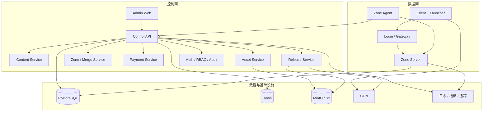

# 系统总览

> 最后更新：2026-11-09
> 状态：生效

## 1. 系统上下文

系统由三类参与者使用：

| 角色 | 主要操作 |
| --- | --- |
| 版本作者 | 创建版本、编辑内容、配置玩法、发布内容、管理资源 |
| 运营/GM | 开区、合区、发补偿、封禁、公告、查看在线和日志 |
| 财务/审计 | 充值订单、对账、退款、审计导出 |
| 玩家 | 登录、选择区服、下载补丁、进入游戏 |
| 平台管理员 | 租户/版本/区服/账号/权限/系统配置 |

## 2. 总体架构



## 3. 控制面组件

| 组件 | 职责 | 关键边界 |
| --- | --- | --- |
| Admin Web | 内容编辑、发布、运营、GM、监控面板 | 只调用 Control API，不直连游戏库 |
| Control API | 鉴权、RBAC、业务编排、审计 | 不包含游戏主循环逻辑 |
| Content Service | 内容模型、校验、导入导出、脚本编译 | 不直接写运行中的区服 |
| Release Service | 内容包、签名、发布、灰度、回滚 | 发布后不可修改 |
| Zone/Merge Service | 区服编排、开区、维护、合区任务 | 通过 Agent 操作区服 |
| Payment Service | 订单、回调、记账、对账、发货 | 不直接改角色资产 |
| Asset Service | 图库、地图、音效、特效、补丁包 | 内容寻址存储 |
| Auth/Audit | 登录、MFA、RBAC、审计日志 | 所有管理操作必须留痕 |

## 4. 数据面组件

| 组件 | 职责 |
| --- | --- |
| Zone Server | 运行现有 `Envir`/`Map`/对象/AI，承载玩家会话 |
| Zone Agent | 心跳、指标、命令、内容拉取、健康检查；MVP 可嵌入 Zone Server |
| Login/Gateway | 登录、版本校验、区服列表、会话路由、限流 |
| Client Launcher | 签名校验、增量下载、原子替换、回滚 |
| Client | 现有 Crystal Windows 客户端，逐步数据驱动化 |

## 5. 核心流程

### 5.1 内容编辑与发布

```text
编辑草稿 -> 保存 -> 校验 -> 编译内容包 -> 签名 -> 发布
-> 区服拉取 -> 预加载 -> 原子切换 -> 指标观察 -> 回滚或归档
```

约束：

- 编辑态使用关系型表，运行时使用不可变内容包。
- 每个内容包有 `release_id`、`schema_version`、`content_hash`。
- 发布失败不能影响当前运行版本。

### 5.2 开区

```text
选择版本模板 -> 分配区服 ID/端口/数据库 -> 生成配置
-> 启动 Zone Server -> Agent 注册 -> 健康检查
-> 拉取内容包 -> 预热地图/脚本 -> 对外开放
```

### 5.3 客户端更新

```text
启动器请求 manifest -> 校验签名 -> 计算本地差异
-> 下载增量或全量 -> 校验哈希 -> 原子替换 -> 启动客户端
```

### 5.4 支付发货

```text
创建订单 -> 支付渠道 -> 回调验签 -> 订单状态机
-> 记账 -> Outbox -> 区服发货 -> 幂等确认 -> 对账
```

### 5.5 合区

```text
预检 -> 冻结写入 -> 备份 -> ID 重映射 -> 数据合并
-> 一致性校验 -> 切换入口 -> 解冻 -> 观察 -> 回滚窗口
```

## 6. 非功能需求

| 维度 | 目标 |
| --- | --- |
| 可用性 | 控制面支持多实例；区服故障可独立隔离 |
| 一致性 | 支付、发货、合区使用事务和幂等；内容发布不可变 |
| 性能 | 后台操作不阻塞游戏主循环；区服 Tick 延迟可观测 |
| 安全 | 管理端 MFA/RBAC；补丁签名；脚本沙箱；审计不可篡改 |
| 可运维 | 一键部署、备份恢复、灰度、回滚、告警 |
| 可扩展 | 新内容类型通过 schema/插件扩展，不改控制面核心 |

## 7. 分阶段边界

- 第一阶段：单区、单版本、核心内容 CRUD、发布、客户端补丁、基础 GM 和监控。
- 第二阶段：服务端热重载、开区编排、合区、支付、完整审计。
- 第三阶段：脚本/插件、多版本模板、多租户、SDK 和生态。

